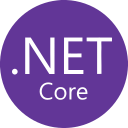

Code and animation experiments.

&nbsp;&nbsp;&nbsp;&nbsp;&nbsp;&nbsp;<picture><source media="(prefers-color-scheme: dark)" srcset="assets/icons/nextjs-dark.svg"></picture>&nbsp;

&nbsp;&nbsp;&nbsp;&nbsp;&nbsp;&nbsp;<picture><source media="(prefers-color-scheme: dark)" srcset="assets/icons/vercel-dark.svg"></picture>&nbsp;

